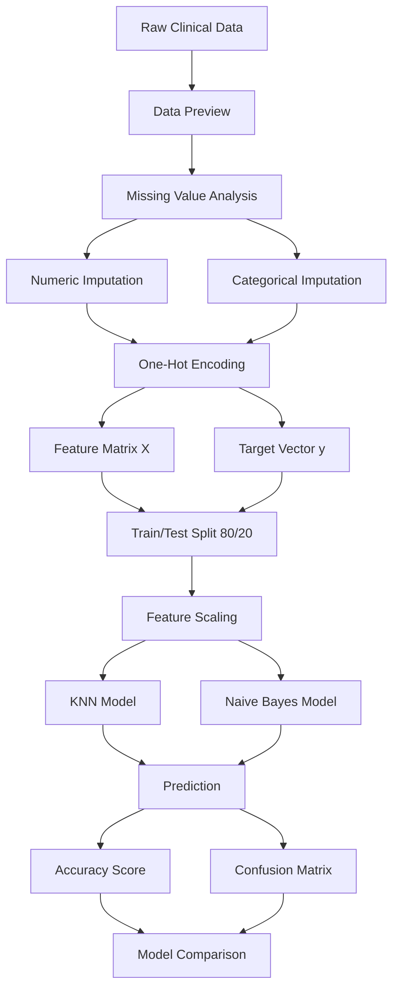
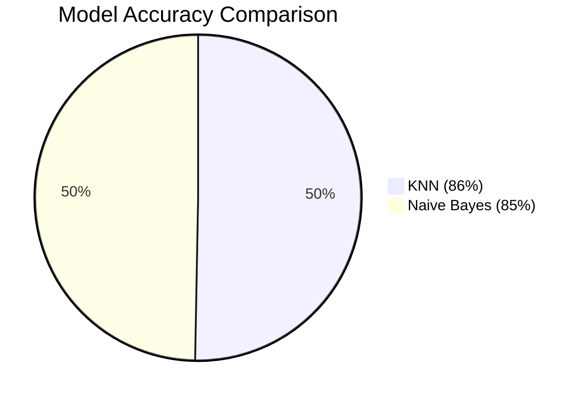
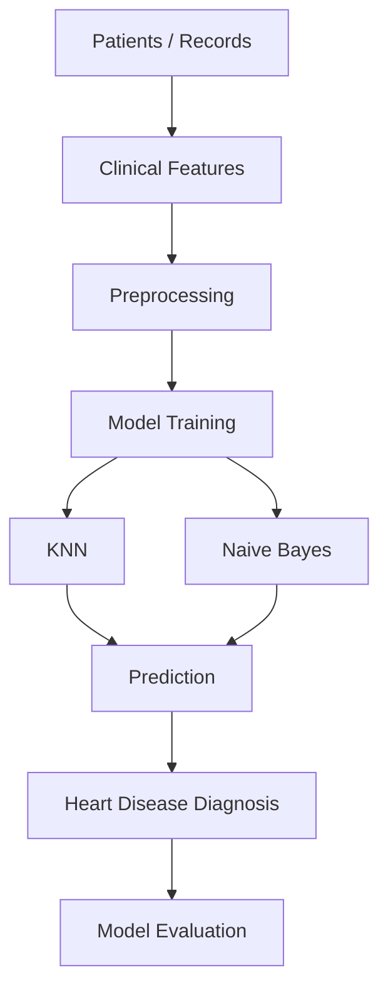

# Heart Disease Classification

A complete machine learning project for predicting whether a patient has heart disease based on clinical indicators such as age, sex, chest pain type, resting blood pressure, cholesterol, ECG results, and exercise-related symptoms.

This repository contains:
- a Jupyter notebook with the full analysis workflow
- a Python implementation of a manual K-Nearest Neighbors (KNN) classifier
- a modified heart disease dataset used for training and evaluation

## Project goal

The goal of this project is to build a reliable binary classification model that predicts:
- 0 = no heart disease
- 1 = heart disease present

The project compares two models:
- K-Nearest Neighbors (KNN)
- Gaussian Naive Bayes

and evaluates them using accuracy and confusion matrix analysis.

---

## Why this project matters

Heart disease remains one of the leading causes of death worldwide. Early detection is critical because many risk factors can be identified from routine clinical data before severe symptoms appear.

This project demonstrates how machine learning can support early screening by turning patient characteristics into a risk prediction model. The notebook and script include practical preprocessing, model training, and evaluation steps commonly used in medical data science.

---

## Dataset

The project uses the file:
- `heart_modified.csv`

The dataset contains medical and demographic variables such as:

- Age
- Sex
- ChestPainType
- RestingBP
- Cholesterol
- FastingBS
- RestingECG
- MaxHR
- ExerciseAngina
- Oldpeak
- ST_Slope
- HeartDisease

The target variable is:
- `HeartDisease` → binary label (`0` or `1`)

### Sample structure

| Feature | Description |
|---|---|
| Age | Patient age |
| Sex | Male/Female |
| ChestPainType | Type of chest pain |
| RestingBP | Resting blood pressure |
| Cholesterol | Cholesterol level |
| FastingBS | Fasting blood sugar |
| RestingECG | Resting electrocardiogram result |
| MaxHR | Maximum heart rate |
| ExerciseAngina | Exercise-induced angina |
| Oldpeak | ST depression induced by exercise |
| ST_Slope | Slope of peak exercise ST segment |
| HeartDisease | Target label |

---

## Repository structure

```text
Heart_Disease_classification/
├── Classification.ipynb       # Full notebook workflow and visual analysis
├── Knn.py                     # Python script implementing the manual KNN model
├── heart_modified.csv         # Heart disease dataset
├── .gitattributes             # Git attributes configuration
└── README.md                 # Project documentation
```

---

## High-level workflow

```mermaid
flowchart LR
    A[Load heart_modified.csv] --> B[Inspect dataset]
    B --> C[Check missing values]
    C --> D[Split numeric and categorical columns]
    D --> E[Impute missing data]
    E --> F[One-hot encode categorical features]
    F --> G[Train/Test split]
    G --> H[Standardize features]
    H --> I{Train models}
    I --> I1[KNN]
    I --> I2[Naive Bayes]
    I1 --> J[Evaluate accuracy]
    I2 --> J
    J --> K[Confusion matrix]
    K --> L[Compare results]
    L --> M[Clinical prediction output]
```



---

## Detailed data pipeline



---

## Model approach

### 1. Data cleaning and preparation

The workflow begins with:
- loading the dataset
- checking null or missing values
- separating numeric and categorical columns
- imputing missing values using:
  - mean for numerical columns
  - most frequent value for categorical columns

After cleaning, categorical features are converted to numerical form with one-hot encoding (`pd.get_dummies`), which is necessary because algorithms like KNN and Naive Bayes do not accept raw string labels directly.

### 2. Train-test split

The project uses:
- an 80/20 train-test split
- `random_state=100` for reproducibility

This ensures the model is evaluated on unseen data rather than the same observations it was trained on.

### 3. Feature scaling

The features are standardized using `StandardScaler`:

```python
scaler = StandardScaler()
X_train_scaled = scaler.fit_transform(X_train)
X_test_scaled = scaler.transform(X_test)
```

This is important for distance-based methods like KNN, because KNN depends on distances between samples. Without scaling, features with larger numeric ranges could dominate the distance calculations.

### 4. KNN model

The project includes a custom KNN implementation in `Knn.py` as a drop-in replacement for `sklearn.neighbors.KNeighborsClassifier`.

The custom classifier:
- stores training data
- computes Euclidean distances between points
- finds the nearest neighbors
- counts class votes among the nearest `k` values
- predicts the majority class

```python
class KNN:
    def __init__(self, n_neighbors=5):
        self.n_neighbors = n_neighbors
        self._fit_X = None
        self._fit_y = None
```

The notebook also uses the scikit-learn KNN implementation for comparison and evaluation.

### 5. Naive Bayes model

The notebook also trains a `GaussianNB` model, which is a probabilistic classifier that assumes features follow a Gaussian distribution.

Even though Naive Bayes is a simple classifier, it often performs surprisingly well on structured tabular health data and is useful as a baseline for performance comparison.

---

## Evaluation metrics

The evaluation includes:
- accuracy score
- confusion matrix
- model comparison between KNN and Naive Bayes

From the notebook results:

- KNN Accuracy: `0.86`
- Naive Bayes Accuracy: `0.85`

This indicates that KNN performed slightly better on this dataset, with roughly a 1–2% improvement in classification accuracy.

### Confusion matrix interpretation

The confusion matrices show:
- true positives (patients with disease correctly identified)
- true negatives (patients without disease correctly identified)
- false positives (healthy patients incorrectly flagged)
- false negatives (diseased patients missed by the model)

In medical prediction, false negatives are especially important because they can delay treatment.

---

## Results summary



The project concludes that KNN performs slightly better on this dataset than Naive Bayes for heart disease classification.

The notebook also includes a comparison table of actual versus predicted labels and flags whether each model prediction was correct.

---

## Why KNN performed well

KNN performs well when:
- the decision boundary is complex
- similar patients tend to have similar outcomes
- local neighborhood structure is informative

For heart disease risk prediction, patients with similar vitals and symptomatic patterns often belong to the same class, which makes KNN a natural fit.

---

## Potential future improvements

This project could be extended with:

- hyperparameter tuning for KNN (`k` value optimization)
- cross-validation for more robust evaluation
- comparison with Logistic Regression, Random Forest, SVM, and XGBoost
- feature importance analysis
- ROC-AUC and precision-recall curves
- SHAP or permutation importance for explainability
- deployment as a simple web app for clinical screening

---

## How to run this project

### Requirements

Install the required Python libraries:

```bash
pip install pandas numpy matplotlib scikit-learn
```

### Run the notebook

Open `Classification.ipynb` in Jupyter Notebook or VS Code and run all cells.

### Run the script

```bash
python Knn.py
```

This script reads the dataset, handles missing values, scales features, trains the KNN model, and prints the accuracy and confusion matrix.

---

## Practical notes

- The dataset is already modified and prepared for classification.
- Missing values are filled before modeling.
- One-hot encoding is required for categorical columns.
- Standardization is especially important for KNN.
- The workflow is suitable for educational and prototype-level medical prediction tasks.

---

## Key takeaway

This repository demonstrates a complete machine learning workflow for heart disease prediction using tabular patient data. It covers data cleaning, categorical feature handling, distance-based classification, and model evaluation in a simple, readable structure.

The project is especially useful for:
- learning classification pipelines
- understanding healthcare data preprocessing
- comparing multiple machine learning algorithms
- building a foundation for more advanced medical AI applications

---

## Contact / repository info

Repository: `seif-mohamed-kamal/Heart_Disease_classification`

This project is intended as a learning-oriented ML application and can be expanded for more advanced clinical modeling and deployment.

---

## Quick project overview diagram



---

## Conclusion

This repository is a practical demonstration of how data science and machine learning can be applied to heart disease detection. The end-to-end pipeline from raw CSV data to prediction and evaluation is simple, interpretable, and educational.

If you want, this project can also be expanded with:
- a web dashboard
- model comparison charts
- more advanced ensemble models
- deployment to Streamlit or Flask
- a polished report with plots and metrics

